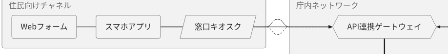
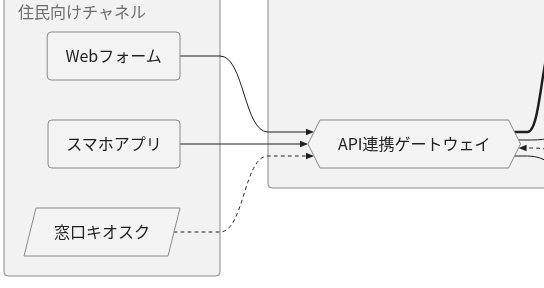

# Pele と Mermaid.js の比較

公開先: <https://yantkys.github.io/poc-lab/pele/>

## 検証目的

[Pele](https://github.com/obsidianmd/pele)（obsidianmd 公式）が Mermaid.js の代替として使えるかを、同じ Mermaid 記法を両方で描画して比較する。比較の観点は見た目、描画時間、互換性の3つ。将来は閉域環境の IIS で使うことを想定しているが、この段階では既存ツールへの組み込みは行わない。

## 使用バージョン

| ライブラリ | バージョン | 同梱ファイル |
| --- | --- | --- |
| Pele（npm: `pele`） | 1.13.0（1.7.0 / 1.8.0 の検証記録は下記に保持） | `vendor/pele.global.js`（約 0.7 MB） |
| Mermaid.js（npm: `mermaid`） | 12.1.0 | `vendor/mermaid.min.js`（約 5.5 MB） |

- バージョンは `package.json` と `package-lock.json` で固定している。インストール済みのバージョンが固定値と異なる場合、`scripts/build.mjs` はエラーで止まる。
- ライブラリはビルド時に `node_modules` から `dist/pele/vendor/` へコピーする。実行時に外部 CDN や外部 API は使わない。
- `npm audit` は mermaid 12.1.0 が同梱する KaTeX について low の指摘を出す（GHSA-238p-pmpm-9mq7）。検証のためバージョンは指定どおりに固定しているが、本番で採用する前に再評価する。

## 画面の機能

- Mermaid 記法のエディタ。入力すると 0.4 秒後に自動で再描画する。
- 同じ入力を Pele（左）と Mermaid.js（右）で描画する。画面幅が 800px 以下のときは縦に並べる。
- サンプルを切り替えられる: 日本語フローチャート、シーケンス図、クラス図、ER図、複雑なフローチャート。`?sample=<key>` で URL から直接開ける。
- 表示幅: 図の表示枠を 1024 / 768 / 480 / 360px に固定し、狭い画面での見え方を比較する。
- フォント: 両エンジンに同じフォント指定を渡す。選択肢は「日本語フォントを列挙」「Windows 向け」「sans-serif のみ」。
- 計測値（詳細は画面下部の「計測値の見方」を参照）:
  - 読込+評価: スクリプトの取得から実行完了まで。
  - 初期化: `mermaid.initialize()` の時間。Pele には初期化 API がないため「不要」と表示する。
  - 初回描画: 読込後に最初の図を描画した時間。
  - 直近の描画: 入力を変更したときの1回分。
  - 計測: 指定回数のウォームアップを捨てたあとの中央値・最小・最大。SVG 文字列の生成時間で、DOM への反映は含まない。
  - 「Pele の文字幅キャッシュを毎回破棄」をオンにすると、初めて描く図に近い条件で計測できる（後述）。
- 描画エラーはエンジンごとのパネルに表示する。片方が失敗しても、もう片方は描画を続け、画面全体は止まらない。ライブラリ自体の読込に失敗した場合も同様。

## 動作確認方法

```sh
npm ci
npx playwright install chromium   # 初回のみ
npm run build                     # dist/ を出力
npm run serve                     # http://localhost:4173/poc-lab/ で配信（GitHub Pages と同じサブパス）
npm test                          # Playwright による自動テスト
```

`npm run serve` は `/poc-lab/` より上のパスに 404 を返す。このため、絶対パスで参照しているファイルがあればテストで検出できる。

自動テスト（`tests/pele.spec.js`、16件）の確認項目:

- トップページから比較ページへ遷移できること（サブパス配信）。表示されるバージョンが Pele 1.13.0 / Mermaid 12.1.0 であること。
- 5種類のサンプルがすべて、両エンジンでエラーなく SVG として描画されること。
- 日本語ラベルが両エンジンで表示され、文字数に見合う幅を持つこと。Pele ではラベルがノードの枠からはみ出さないこと。
- 構文エラーと未対応の記法がエンジンごとに表示され、正しい入力に戻すと復帰すること。Mermaid がエラー用の要素を body に残さないこと。
- Pele と Mermaid のどちらか一方の読込を失敗させても、もう一方は描画できること。
- 計測（ウォームアップ後の値、キャッシュ破棄モード）の結果が表示されること。
- 表示幅を 360px にすると両エンジンともその幅に収まること。375px 幅の画面では縦に並び、横スクロールが出ないこと。
- フォントの切替が両エンジンに反映されること。
- 全テスト共通の条件: 外部への通信が 0 件、`/poc-lab/` 外へのリクエストや 404 がないこと、未捕捉の例外がないこと。

CI（GitHub Actions）では、各サンプルの比較画面のスクリーンショットを `playwright-report` アーティファクトに保存している。

## 確認できた結果

以下の既存の結果・未検証事項・2026-10-21の採用判断は当時の記録として保持する。最新の再検証と判断は末尾の「Pele 1.13.0 での再検証」を参照。

「互換性」「見た目」「描画時間」「配信」の各項と、その表の数値は **Pele 1.7.0 での結果**で、1.8.0 では再測定していない（1.8.0 に流用しない）。1.8.0 で確認した内容は次節にまとめた。

確認環境: Linux コンテナ上の Headless Chromium 141（Playwright 1.56.1）。日本語フォントは IPAゴシックと WenQuanYi。下表の数値はこの環境での一例で、端末によって変わる。

### 互換性

- 5種類のサンプルはすべて、両エンジンでエラーなく描画できた。
- 両エンジンとも、図の種別を同じように判定した（flowchart-v2 / sequence / classDiagram / er）。
- 構文エラーはどちらも `Parse error on line N` 形式で報告された。Pele はこれに加えて `code`（`syntax` / `unsupported-diagram` など）と行・列を返す。
- 今回の検証は上記5種類の範囲に限る。そのほかの図種別や記法（スタイル指定、クリックイベント、テーマ設定など）の互換性は未検証。

### 見た目

- 日本語ラベル: Mermaid は既定の折り返し幅で単語の途中でも改行する（例: 「書類に不備はある／か？」「申請者へ補正を依／頼」）。Pele は1行のまま、ノードの大きさを文字幅に合わせた。
- 配色: Mermaid 12 の既定テーマはノードごとに色分けする。Pele はグレー基調で、配色は CSS 変数（`--pele-*`）で変更できる。
- SVG のサイズは Pele が 6〜12 KB、Mermaid が 34〜123 KB だった。
- 狭い画面（表示幅 360px、横長の複雑なフローチャート）: Mermaid は図全体を縮小するため、文字が判読できない大きさになった。Pele は `mount()` がコンテナ幅に合わせて再レイアウトし、LR を TB に切り替えて文字を読める大きさに保った。
- 一方、Pele は図がはみ出すとズームボタン（＋／−）を自動で表示し、図の右上の一部と重なった（`zoom: 'auto'` が既定）。

### 描画時間（Pele 1.7.0。ms、ウォームアップ3回のあと10回計測した中央値）

| サンプル | Pele 初回描画 | Pele 計測 | Pele 計測（文字幅キャッシュ破棄） | Mermaid 初回描画 | Mermaid 計測 |
| --- | ---: | ---: | ---: | ---: | ---: |
| 日本語フローチャート | 115 | 1.4 | 69 | 447 | 111 |
| シーケンス図 | 145 | 0.8 | 126 | 87 | 37 |
| クラス図 | 231 | 1.1 | 170 | 537 | 190 |
| ER図 | 275 | 1.0 | 280 | 293 | 112 |
| 複雑なフローチャート | 215 | 2.7 | 125 | 393 | 181 |

- 読込+評価: Pele は約 30〜160 ms、Mermaid は約 210〜740 ms で、ページを開くたびにばらつきが大きかった。`mermaid.initialize()` は約 3〜6 ms。
- 同じ図を再描画する場合（文字幅キャッシュあり）は、Pele が Mermaid より数十〜百数十倍速かった（上表では約 45〜170 倍）。
- 初めて描く文字列を含む場合（キャッシュ破棄）は、この環境では Pele が常に速いとは言えなかった（シーケンス図と ER 図では Mermaid より遅い）。
- 原因: Pele は文字列ごとに文字幅を計測し、キャッシュする前に `document.fonts.check()` を呼ぶ。この呼び出しの所要時間が、フォント指定に含まれる「インストールされていないフォント名」の数に応じて増える。ER 図でキャッシュを破棄して計測した例:

  | フォント指定 | 中央値 |
  | --- | ---: |
  | 日本語フォントを5つ列挙 | 約 200 ms |
  | `"Noto Sans CJK JP", sans-serif`（この環境には未インストール） | 約 38 ms |
  | `sans-serif` のみ | 約 1.4 ms |

  実際に使う環境では、確実に存在するフォントだけを指定するのが有効と見込まれる。ただし Windows では未検証。

### 配信

- ローカル検証では、`/poc-lab/` のサブパス配下にある相対パスだけで動作した（テストで確認）。外部への通信は0件だった。
- `dist/pele/index.html` を `file://` で直接開いても、両エンジンで描画できた（Chromium で確認）。ES Modules（`.mjs`）は使わず、通常の `<script>` だけで構成している。

## Pele 1.8.0 での確認（サブグラフを含むフローチャート）

Pele 1.8.0 はサブグラフを含むフローチャートの接続線配置が改善されたとされる。「複雑なフローチャート」で、独立した入口（Webフォーム・スマホアプリ・窓口キオスク）が連続した処理フローのように見える問題が、1.8.0 で改善されるかを確認した。Mermaid.js は 12.1.0 のまま、サンプルの記法は変更していない。

結論: **この問題は 1.8.0 でも改善されなかった。**

| 条件 | 1.7.0 | 1.8.0 | 入口の独立性 |
| --- | --- | --- | --- |
| 既定幅（`render()`、LR 配置） | 3本の線が同じ高さの水平線に重なる | 1.7.0 と完全に同一（SVG 文字列が一致） | 判読できない |
| 比較ページのペイン幅（約 660px） | 同上 | 1.7.0 と完全に同一 | 判読できない |
| 狭い幅（360px、TB 配置） | 3本が別々の経路で合流 | 約 5px 横にずれた以外は同じ | 判読できる |

- 既定幅では、Webフォーム → API連携ゲートウェイ、スマホアプリ → API連携ゲートウェイ、窓口キオスク → API連携ゲートウェイの3本の線がすべて同じ高さ（y=189.65）の1本の水平線に重なる。Webフォームの線はスマホアプリと窓口キオスクの背後を通り抜け、スマホアプリの線は窓口キオスクの背後を通る。そのため、「Webフォーム — スマホアプリ — 窓口キオスク → ゲートウェイ」と連結した処理フローに見え、各入口が個別にゲートウェイへ接続しているとは読み取れない。接続座標も1.7.0と同じだった。
- 狭い幅では、Pele が TB 配置に切り替わり、3つの入口から別々の線が下へ伸びて合流するので、各入口は独立して見える。これは 1.7.0 でも同じだった。
- 他の4サンプル（日本語フローチャート、シーケンス図、クラス図、ER図）は、`render()` の既定出力、`maxWidth` 660px、同 360px のいずれも 1.7.0 と同一だった。複雑なフローチャートの 360px だけが、前述の約 5px のずれで異なった。
- 回避策（サンプルの書き換え、Pele の設定変更、独自パッチ）は実装していない。

確認内容:

- `npm run build` と既存の Playwright テスト 16件が 1.8.0 で成功した。バージョンを固定で確認するテスト 1件の期待値だけを 1.8.0 に更新した。
- 比較ページ上でも、5種類のサンプルが両エンジンで描画できた。
- 1.7.0 と 1.8.0 の `pele.global.js` を同じ条件で描画して比較した。この比較は一度限りの調査で、リポジトリには含めていない。
- 1.8.0 の性能（描画時間）は、この更新では測定していない。

## 未検証事項（成功扱いしない）

- GitHub Pages（`https://yantkys.github.io/poc-lab/pele/`）での実際の表示。1.7.0 では、main への実行でビルド・テスト・デプロイのジョブが成功した（初回2回の実行は失敗しており、原因は調べていない。のちの再実行で成功した）。ただし、公開URLを実際に開いての確認はしていない。1.8.0 の公開後の表示も同様に未確認。
- IIS への配置と表示。使っている拡張子は `.html` / `.js` / `.css` / `.txt` で、いずれも IIS の既定 MIME タイプに含まれるため、`web.config` は不要の見込み。
- 閉域ネットワーク（インターネット接続なし）の実機での動作。
- Windows の実フォント（游ゴシック、メイリオ）での見た目と描画時間。上記の `document.fonts.check()` のコストも含む。
- Chromium 以外のブラウザ（Edge は Chromium 系だが未確認。Firefox と Safari も未確認）。
- 今回のサンプル以外の図種別と記法の互換性。大規模な図（数百ノード）での性能。
- Pele 1.8.0 の描画時間。1.7.0 の測定値は流用していない。

## 採用判断（2026年10月21日）

**判定: 採用保留・PoC検証終了**

- Pele は Mermaid.js と比べて、描画速度、ライブラリの軽量性、狭い画面への対応に優位性が確認された。
  - 描画速度: 同じ図の再描画（文字幅キャッシュあり）は Mermaid.js より大幅に速かった（Pele 1.7.0 の測定で約 45〜170 倍）。ただし初めて描く文字列を含む場合は、図とフォント指定によって Mermaid.js より遅いことがあった。1.8.0 の描画時間は測定していない。
  - ライブラリの軽量性: 同梱ファイルは Pele が約 0.7 MB、Mermaid.js が約 5.5 MB。出力する SVG も小さい（6〜12 KB に対して 34〜123 KB）。
  - 狭い画面: 表示幅 360px の複雑なフローチャートで、Mermaid.js は図全体を縮小して文字が判読できなくなり、Pele は再レイアウトして読める大きさを保った。ほかのサンプルでは、狭い幅での比較をしていない。
- 一方、複雑なフローチャートでは、独立したノードが連続した処理フローのように見える問題が確認された。既定幅（LR 配置）では、住民向けチャネルの3つの入口からゲートウェイへの線が1本の水平線に重なる。Mermaid.js では、同じ記法で3つの入口が別々の線で接続し、独立して読める。
- Pele v1.8.0 でも、この描画上の問題は改善されなかった（既定幅の描画は 1.7.0 と同一）。
- 業務フロー図では、描画速度よりも接続関係の正確な伝達を優先する。
- 現時点では既存の Mermaid.js を継続利用し、Pele への置き換えは行わない。
- Pele の今後の更新で関連するレイアウト改善が行われた場合は、既存のサンプル（特に「複雑なフローチャート」）を使って再検証する。

この判断は、上記までに確認した範囲に基づく。「未検証事項」（IIS への配置、Windows の実フォント、閉域ネットワークなど）は確認しておらず、判断の根拠にしていない。


## Pele 1.13.0 での再検証（2026-11-01）

**判定: 再評価候補。対象サンプルの入口3本の独立性は改善した。実利用への採用・他リポジトリへの展開は未決定。** 2026-10-21の採用保留は当時の記録として残す。今回も描画速度より接続関係の正確さを優先して判断した。

[Issue #8](https://github.com/YanTKYS/poc-lab/issues/8) に基づき Pele を **1.8.0 → 1.13.0** に厳密固定で更新した。Mermaid.js は **12.1.0** のまま、`pele/samples.js` の5サンプルは変更していない。API/CDNへの実行時依存や描画の回避策は追加していない。

確認環境: Linux、Node.js 24.19.0、Playwright 1.56.1、Headless Chromium 154.0.8037.57、1400×1000、deviceScaleFactor 1、ja-JP。比較UIの既定フォント列を使い、実際に利用できる日本語フォントは Noto Sans CJK JP。両Pele版・Mermaidを同じ環境で比較した。過去のChromium 141／IPAフォントの計測と混同しない。

### 最重要課題: 入口3本の接続

| 条件 | Pele 1.8.0 | Pele 1.13.0 | Mermaid.js 12.1.0 |
| --- | --- | --- | --- |
| 既定幅 `render()`、LR | 入口3ノードが横一列。線が他の入口ノードの背後を通り、連続フローに見える | 入口が縦並びになり、3本が別々にGWへ到達。入口同士が連結して見える問題は今回のサンプルでは解消 | 入口が縦並びで3本は独立 |
| 実UIの通常ペイン652px、および分離した660pxの `mount()` | LRのままで同じ問題が残る | LRで独立した3本を確認。ただし図全体が小さく縮小され、文字視認性には制約あり | 3本の構造は独立。全体を縮小して表示 |
| 360pxの `mount()` | TBへ切り替わり3本は独立 | TBへ切り替わり3本は独立。以前から判読できた条件を維持 | LRのまま全体を縮小し、文字の判読が難しい |

既定幅の入口部分を同じCSSピクセル倍率で切り出した画像:

| Pele 1.8.0 | Pele 1.13.0 |
| --- | --- |
|  |  |

SVG経路でも確認した（座標は今回の同条件比較、SVG内の単位）:

- **1.8.0、既定LR:** W/M/K の中心はすべて `y=187.72`。W→GW の線はM・Kの背後、M→GWはKの背後を通る。3本とも同じ終点 `(678.53,187.72)` へ入り、途中の曲線部分以外も共通の水平線上に重なる。
- **1.13.0、既定LR:** W/M/K の中心は `y=296 / 384 / 472`。終点はそれぞれ `(311,372)`、`(305,384)`、`(311,396)` で、入口3ノードの背後を横切らず別々の位置へ到達する。Kの破線も区別できる。
- **1.13.0、660px:** 入口の中心 `y=233 / 301 / 369`、GW側の終点 `y=314 / 326 / 338`。3本が同一点へ潰れる状態はない。
- **1.13.0、360px:** 終点のx座標は `318.86 / 334.86 / 350.86`、yは `217`。上から別々に入る。旧版は同じx座標群で `y=249` だった。

目視したPNG、全SVG、ノード・エッジ座標、実UIの比較画像、ライブラリ／サンプルのSHA-256は [証跡一覧](../evidence/pele-1.13.0/README.md) と [observations.json](../evidence/pele-1.13.0/observations.json) に保存した。画像を見ずにSVG生成成功だけで改善判定したものではない。通常UIではフレーム実幅652pxに対し1.13.0のSVG表示幅は610px（1.8.0は652px）。ズーム操作部も含む縮小表示で、日本語ラベルの読みやすさは実利用条件で追加評価が必要。

[v1.13.0のリリースノート](https://github.com/obsidianmd/pele/releases/tag/1.13.0)、[direction関連 #82](https://github.com/obsidianmd/pele/issues/82)、[境界エッジ関連 #97](https://github.com/obsidianmd/pele/pull/97) に関連する変化は観察できたが、中間バージョンを比較していないため、どの修正がどれだけ寄与したかは切り分けていない。

### 回帰確認

- `npm run build` 成功。既存の固定バージョン検査は維持し、画面も Pele 1.13.0 / Mermaid 12.1.0 と表示する。
- **既存Playwright 16件すべて成功**。5種類の描画、日本語のラベル幅、エラー復帰、片側の読込失敗、計測UI、360px表示、375px画面、フォント切替を確認した。全テストの外部通信・サブパス外／404・未捕捉例外の検査も成功。
- 最初の実行は15件成功・1件失敗。幅変更直後の再描画中にSVGが一時的になくなり、テストがnullの幅を読んで停止した。SVG不在時は幅をInfinityとしてポーリングを継続するよう、テストの待ち方だけを調整した。最終的な「SVG幅 ≤ 360px」の条件は維持し、再実行で16件成功した。アプリコードの回避策は入れていない。
- 残り4サンプルは両Pele版の同条件 `render()` でも成功。新バージョンの比較UIではMermaidを含む全5サンプルが成功した。全図種別・全エッジの正確さを網羅検証したものではない。

### 補助計測（両Pele版を今回同じ条件で測定、ms）

既定幅の `render()` によるSVG文字列生成。3回ウォームアップ後10回の中央値。右2列は各測定の直前に `forgetTextWidths()` を呼んだ。同じ指定フォント・環境での短い逐次測定1回の参考値で、DOM反映・初回読込・ネットワークは含まない。タイマー分解能、GC、測定順の影響を含むため、小差の優劣や一般的な高速化を主張しない。旧1.7.0の数値は流用していない。

| サンプル | 1.8.0 キャッシュあり | 1.13.0 キャッシュあり | 1.8.0 キャッシュ破棄 | 1.13.0 キャッシュ破棄 |
| --- | ---: | ---: | ---: | ---: |
| 日本語フローチャート | 0.65 | 0.85 | 1.20 | 1.35 |
| シーケンス図 | 0.15 | 0.20 | 1.40 | 1.40 |
| クラス図 | 0.35 | 0.40 | 1.35 | 1.70 |
| ER図 | 0.40 | 0.30 | 1.80 | 1.90 |
| 複雑なフローチャート | 2.20 | 4.75 | 3.10 | 2.65 |

### 適用可能性と未検証事項

今回の採用見送り理由だった入口の誤読は解消したため、Peleは**再評価候補**とする。ただし、通常幅の縮小表示、複雑な図の残りの接続経路、対象業務で使う追加記法、Windowsの実フォント、IISへの配置、閉域実機、Chromium以外のブラウザ、大規模図は未検証。GitHub Pagesへの1.13.0公開後の実表示も未確認であり、自動的な他リポジトリへの導入は行わない。次に実利用の代表図と表示幅で読みやすさ・接続関係を確認してから採否を決める。
